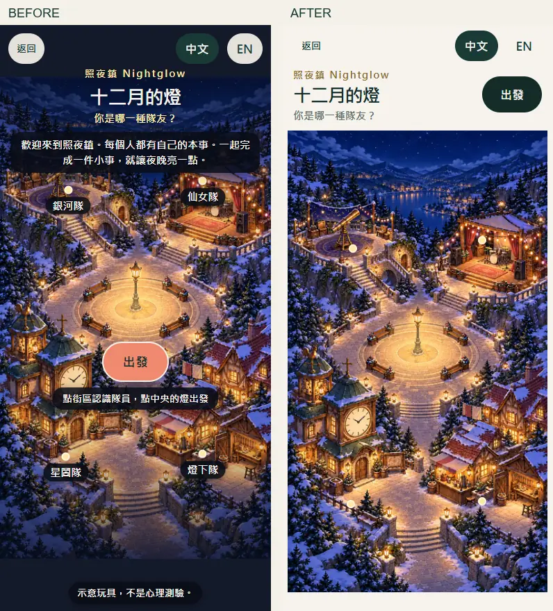
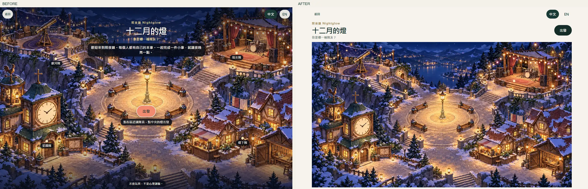
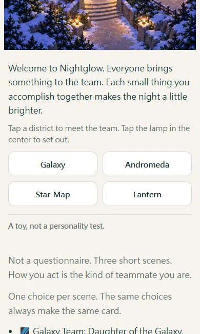

# December Lights: an unobstructed cover map

The cover previously placed the title, introduction, start button, instruction and faction labels on top of the map. At 1440 × 900, the fill-screen frame also clipped the horizontal map's edges.

## Changes

- Title, subtitle and the existing start button sit above the map. The start button remains in the first viewport.
- Introduction, instructions, faction text entrances and the existing boundary sentence sit below the map.
- Desktop and mobile maps retain their full compositions and original aspect ratios. The extra dark gradient is removed.
- Small map markers, existing district hit areas, the central lamp action and keyboard focus indicators remain available.
- Four outside faction buttons use the existing `data-faction` action. Escape closes the preview and returns focus to its opener.

Only `prototype/teammate-type/index.html` changes production content. Its original map image files, `app.js`, story text, result logic, share-code format, download-card logic and next-work connection are unchanged. No new dependency or illustration is introduced.

## Before / after

Before screenshots are from the production diagnosis on 2026-10-17; after screenshots show the proposed branch. Left is before, right is after. These are Chrome viewport simulations, not physical-phone tests.

The information and text entrances are below the map, rather than covering it:

## Verification

- Unit tests: 88 passed.
- Build passed; the existing large-chunk advisory remains.
- Export presence: 58 passed; journey-language checks: 105 passed; one-pager sync and document parity passed.
- New cover checks: 6 passed (zh/en × 390/768/1440). Verify complete image proportions, horizontal containment, text/control regions outside the map, visible first-screen start action, outside faction buttons, original map actions, Escape/focus return and no runtime errors.
- Existing cover/map/mobile flow regression: 3 passed. These include multiple viewport/language combinations, district preview, quiz, result and duo.
- The full-suite result is recorded in the PR after the serial run completes. Targeted checks are not presented as a full-suite pass.

The previous viewport-only assertions were updated to test the new layout contract: the image is contained horizontally, text is outside it, and district hit areas remain within the map. The page can scroll vertically to its introduction and team list.

No merge or production deployment is authorized in this round. Draft PR for Paul to review.
