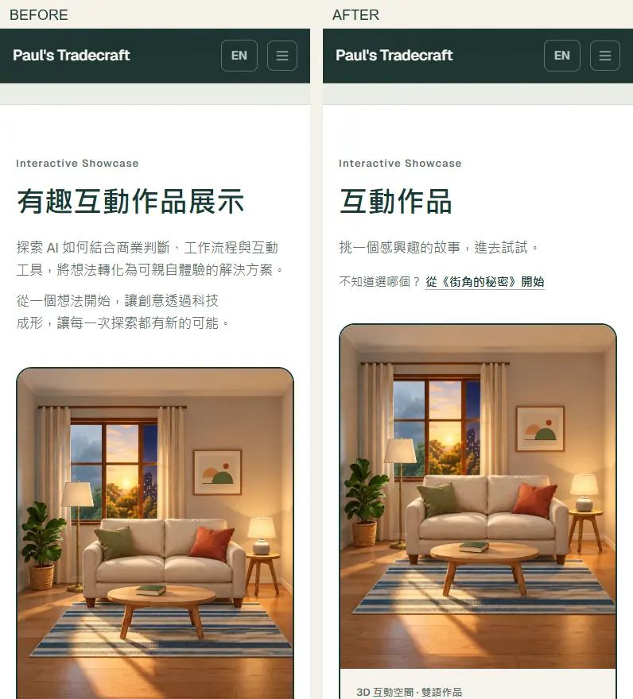
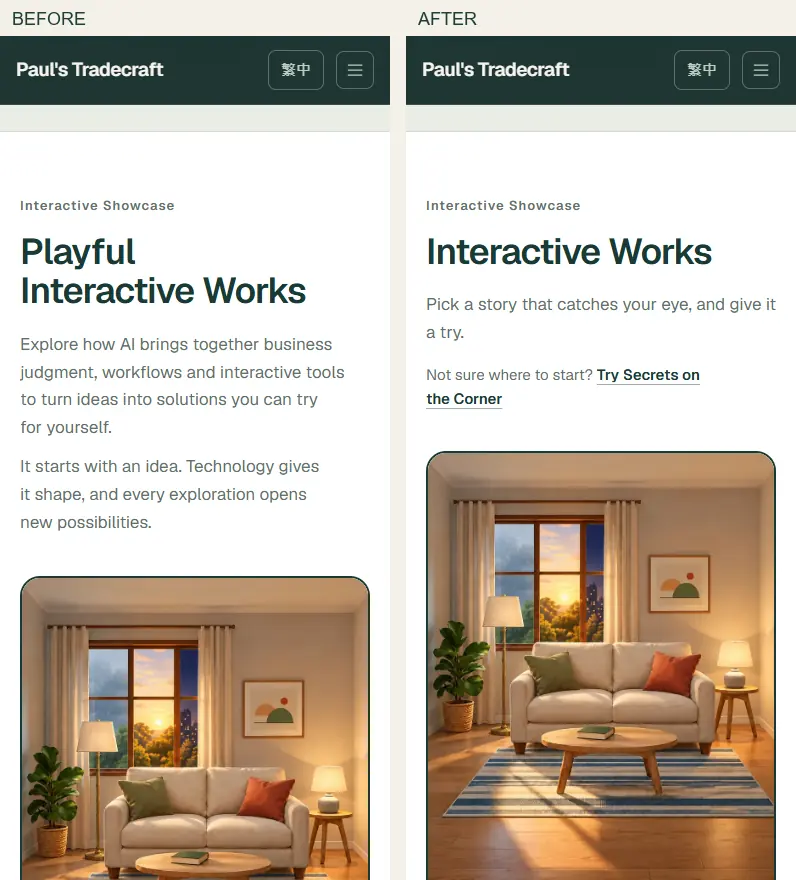
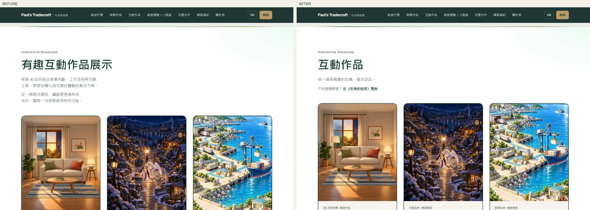
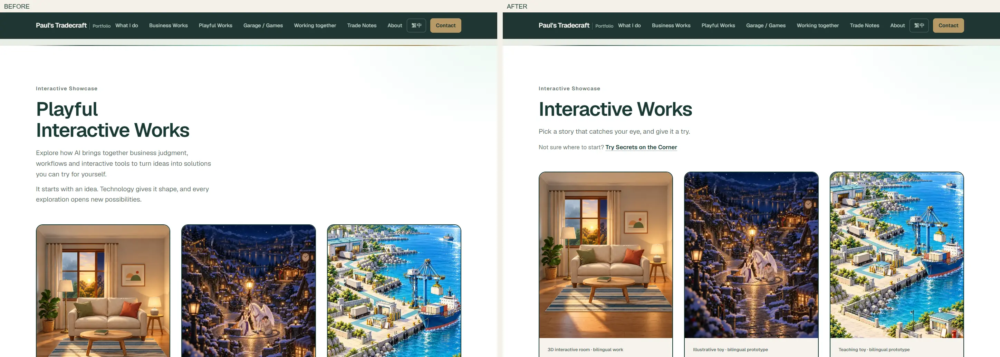

# Interactive showcase: simpler entry and next-work audit

Scope: homepage title, introduction, optional starting link and bilingual activity/takeaway copy. Existing work order, covers and direct card links remain available.

Two navigation gaps were repaired:
- December Lights now offers A Lamp, As Promised after the result, outside the downloadable role card.
- A Lamp, As Promised already linked to Match the Lamp on the Shelf, but its story copy still named Trade Street. The bilingual description now matches the destination.

## Existing connections

| Work | Next-work entry |
| --- | --- |
| December Lights | A Lamp, As Promised (added) |
| Secrets on the Corner | A Lamp, As Promised; Trade Street remains secondary |
| A Lamp, As Promised | Match the Lamp on the Shelf |
| Match the Lamp on the Shelf | Trade Street; return to A Lamp, As Promised |
| Trade Street | A Lamp, As Promised; Secrets on the Corner |
| Room Mode Remote | Match the Lamp on the Shelf |

ROOMVERSE 3D is excluded from the next-work audit as requested. These links remain optional, rather than a required sequence. The new browser checks inspect rendered bilingual links and confirm their targets return HTTP 200; Room Mode Remote is taken through to its result. Existing lamp tests cover all six screens.

## Before / after

Each comparison shows the production page on the left and the proposed page on the right. Screenshots use desktop Chrome and simulated mobile viewport widths, not a physical iPhone.

## Validation boundary

- Unit tests: 88 passed.
- New entry/navigation browser suite: 10 passed (zh/en at 390, 768 and 1440; all six next-work routes in both languages).
- Existing lamp full-flow and Room Mode Remote navigation checks: 8 additional cases passed at 390/1440 in zh/en before the interrupted run was stopped.
- Production build passed; existing large-chunk advisory remains.
- Export presence: 58 passed. Journey-language checks: 105 passed.
- One-pager sync and document parity passed.
- Full Playwright suite: attempted (415 tests), stopped when parallel browser runs overloaded the local machine. This is **not** a full-suite pass. Focused results are recorded in the PR after rerunning serially.
- No merge or production deployment in this round.

The document-parity guard still limits the previously approved AI sentence to its original header location if used. Its presence is now optional because the owner approved replacing the introduction with shorter visitor-facing copy.
