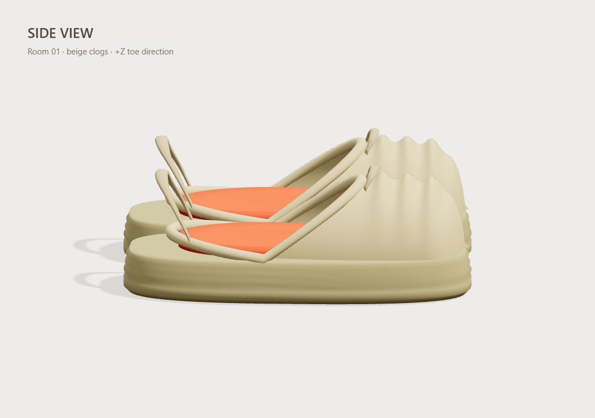
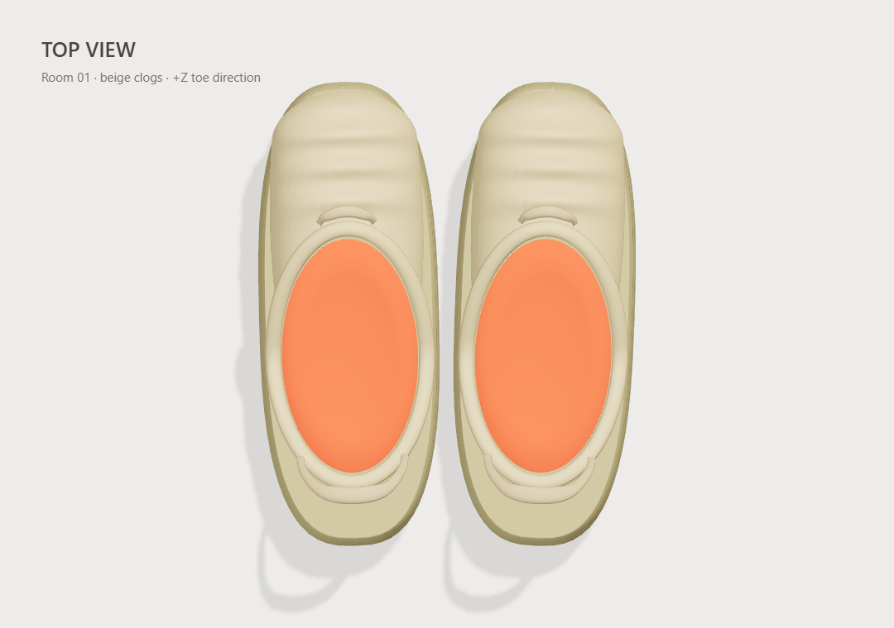
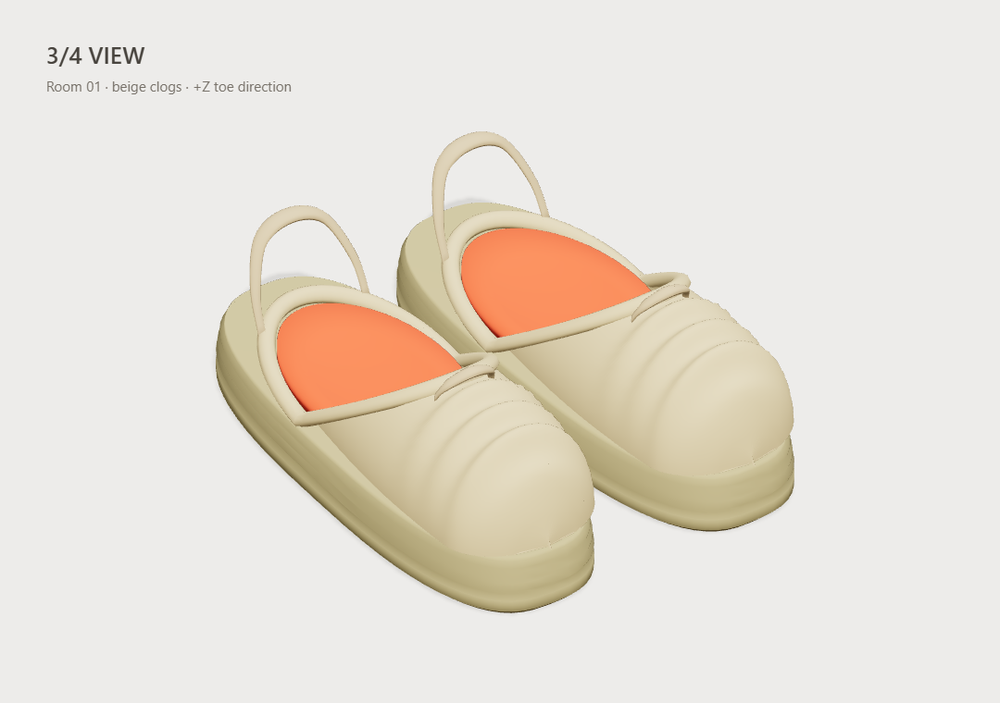

# Room 01 beige clogs — asset evidence

## Measured GLB

- Asset: `public/prototype/roomverse-3d/models/room01-clogs-beige-v1.glb`
- File size: **297,064 bytes** (290.1 KiB; below the 300,000-byte limit)
- Geometry: **8,182 vertices**, **16,208 triangles**, 4 meshes / 4 primitives
- Combined bounds: **216.1 mm wide × 265.9 mm long × 98.5 mm high**
- Ground contact: minimum **Y = 0.000 m**; toe direction is **+Z**
- Materials: `upper`, `sole`, `lining`, `loop`
- All four materials use opaque rendering. The file contains no images or textures.
- Geometry attributes: `POSITION`, `NORMAL`

Measurement command: `node C:/Users/grays/.agents/skills/web-3d-asset-verification/scripts/glb-inspect.mjs public/prototype/roomverse-3d/models/room01-clogs-beige-v1.glb`; bounds were combined from the POSITION accessor min/max values.

## Topology and loading

`glb-topology.mjs` reports 12 connected components, which correspond to the designed pieces in the two shoes: upper shell and padded cuff, sole, lining footbed, and two loops per shoe. The only 124 boundary edges are the intentionally open shoe mouths. The upper is closed across the toe and along its underside; the footbeds, soles, and loops are watertight. The audit reports **0 non-manifold edges, 0 degenerate triangles, and 0 inconsistent-winding edges**.

The GLB loaded successfully through Three.js `GLTFLoader` and rendered from the three views below. The shoe bodies are opaque; orange is visible only inside the intended shoe openings. No see-through body surfaces appeared in the render. This is a procedural casual-clog interpretation and does not try to reproduce every detail of the reference photo.

## Reference feature check

- Rounded closed toe and thick beige sole: visible in side and 3/4 views.
- Four shallow raised arcs over the toe: visible in the top and 3/4 views.
- Orange-red lining inside an oval shoe opening: visible in all three views.
- Heel pull loop and small front loop: visible in the top and 3/4 views.
- No laces, brand marks, or logos.

## FACT / INFERENCE / UNKNOWN

- **FACT:** The GLB includes the measured dimensions, four required material names, opaque materials, and the topology results above.
- **INFERENCE:** The silhouette reads as a pair of casual closed-toe clogs. Paul has said close photo matching is not required.
- **UNKNOWN:** Fit between the Room 01 doorway and umbrella stand, and appearance under the actual Room 01 lighting after integration. The model has not been loaded into Room 01; CC will place and test it.

## Render evidence

All renders are 1080 × 760 screenshots of the GLB loaded with Three.js `GLTFLoader`.

